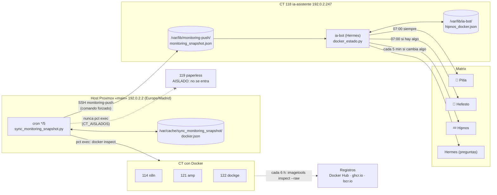
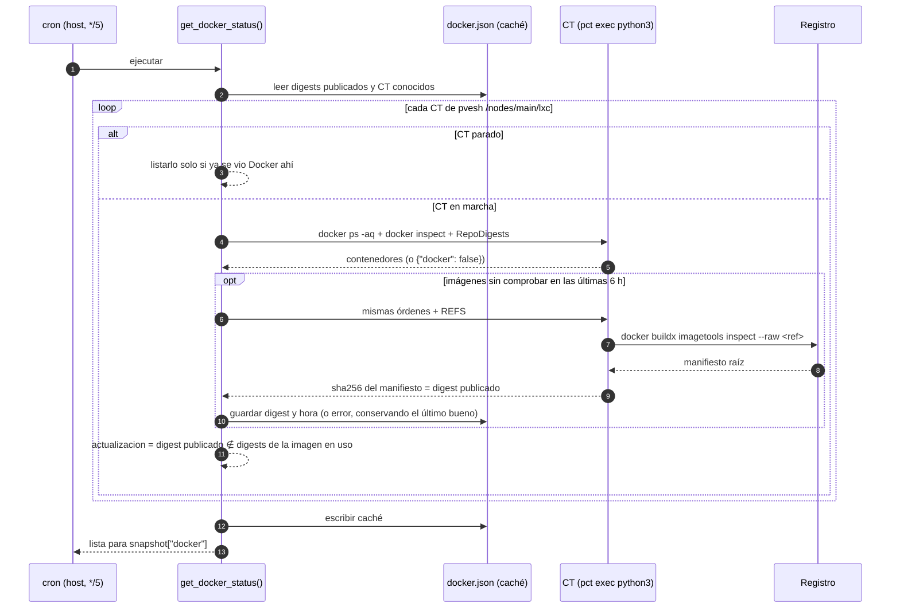
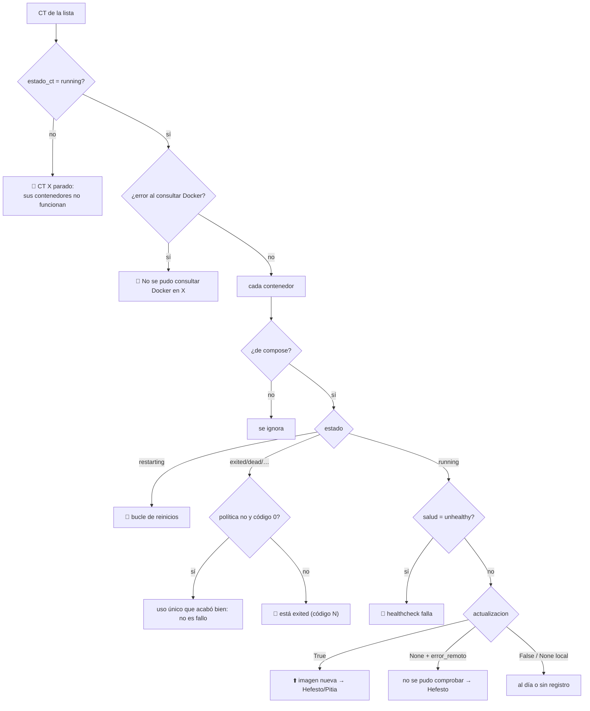
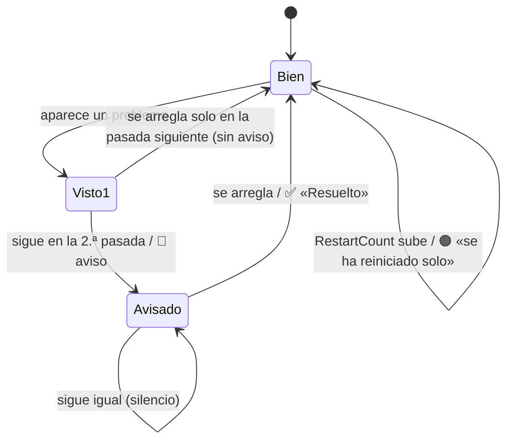
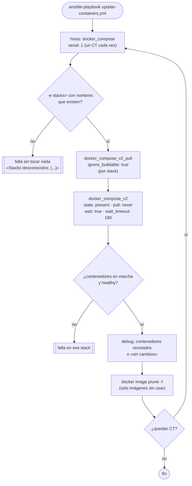

# Docker — vigilancia, avisos y actualización con Ansible

Fecha: 24-09-2026. Sustituye a Dockge, que no se reinstaló en el CT 122 tras la
migración del 19-09: la ruta `dockge.home.arpa` de Caddy apunta a `127.0.0.1:5001`,
donde no escucha nada, y responde 502.

Objetivo: saber cada día qué contenedor tiene imagen nueva, enterarse al momento
de lo que se cae y actualizar desde Ansible, que sigue siendo la fuente de verdad
de los `compose.yaml`.

Commits: `051f870` (snapshot), `f6318f7` (bot), `d212ba5` (playbook),
`dc79e9f` (zona horaria), `8f0fef2` (avisos diarios a las 07:00).

## 1. Visión general



| Pieza | Dónde | Gestionado por |
|---|---|---|
| Recogida del estado | `scripts/sync_monitoring_snapshot.py`, `get_docker_status()` | Copia manual al host (sección 7) |
| Lógica de avisos | `ansible/roles/ia_asistente/files/docker_estado.py` | Role `ia_asistente` |
| Envío a Matrix | `ia_bot.py`: `_build_pitia_digest`, `_check_hefesto`, `hipnos_docker_watcher` | Role `ia_asistente` |
| Herramientas de Hermes | `ia_tools.py`: `get_hefesto_status`, `get_hipnos_status` | Role `ia_asistente` |
| Actualización | `ansible/playbooks/update-containers.yml` + grupo `docker_compose` | Ansible |

## 2. Recogida: el snapshot del host Proxmox

El script ya existía (Zabbix, Wazuh, apt, ZFS…). Corre como root por cron cada
5 minutos en el host, el único sitio con `pct exec` a todos los CT, y empuja el
JSON al CT 118. La parte de Docker se añadió en `get_docker_status()`.



### Qué se guarda por contenedor

| Campo | Origen | Significado |
|---|---|---|
| `nombre` | `docker inspect .Name` | Nombre del contenedor |
| `proyecto` | etiqueta `com.docker.compose.project` | `None` si no es de compose (los `AMP_*`) |
| `estado` | `.State.Status` | `running`, `exited`, `restarting`… |
| `salud` | `.State.Health.Status` | `healthy`/`unhealthy`/`None` sin healthcheck |
| `codigo_salida` | `.State.ExitCode` | Último código de salida |
| `reinicios` | `.RestartCount` | Reinicios hechos por Docker |
| `politica` | `.HostConfig.RestartPolicy.Name` | `unless-stopped`, `no`… |
| `imagen` | `.Config.Image` | Etiqueta del compose, p. ej. `lscr.io/linuxserver/radarr:latest` |
| `digests_locales` | `RepoDigests` de la imagen **en uso** | Vacío en imágenes construidas en local |
| `digest_remoto`, `remoto_comprobado_en`, `error_remoto` | caché | Último digest publicado y cuándo se consultó |
| `actualizacion` | calculado | `True` hay imagen nueva · `False` al día · `None` sin comprobar |

Cómo se decide que hay actualización: el digest que publica el registro para la
etiqueta no es ninguno de los digests de la imagen con la que corre el contenedor.
Así también se detecta una imagen ya descargada con el contenedor sin recrear.
Por qué `--raw`: es una sola petición (~2 s), y su sha256 es exactamente el digest.
La primera versión usaba `--format` y descargaba los manifiestos de cada
arquitectura: más lenta, y fallaba con `bazarr` en ghcr.io.

Límites y tiempos, medidos el 23/24-09 con 28 contenedores en 4 CT:

- Pasada normal (sin consultar registros): unos 36 s.
- Pasada que consulta los ~25 registros: unos 80 s. El script completo tardó 2 min 1 s
  en la primera ejecución, todavía dentro de los 5 min del cron.
- Tiempo máximo: 45 s por imagen, y `60 + 50 × n` s por CT en la llamada con `n` imágenes.
- Los registros se consultan como mucho cada 6 h por imagen (`DOCKER_REMOTO_TTL`),
  lo que da ~100 consultas al día, dentro del límite anónimo de Docker Hub.
- Una actualización publicada puede tardar hasta 6 h en aparecer.
- Si falla `get_docker_status` entero, `snapshot["docker"]` queda `[]` y el resto
  del snapshot sigue llegando (`_seguro`).

### CT aislados: Paperless

Paperless (CT 119) está **aislado** por decisión mía (22-09, reiterada el
24-09): documentos oficiales y confidenciales, fuera del alcance de los agentes IA.
`CT_AISLADOS = {119}` hace que el script **no entre nunca en él con `pct exec`**:
ni para Docker ni para el recuento de paquetes apt de Hefesto, que ya existía
antes. Lo que Proxmox ve desde fuera con `pvesh` (encendido, CPU, RAM, disco) se
sigue listando, porque no entra en el CT. Tampoco está en `update-containers.yml`.
Sus digests se borraron de la caché el 24-09.

Riesgo conocido, **ajeno a Docker**: `get_zabbix_problems` no está protegido.
Si el login en la API de Zabbix (CT 130) supera el tiempo máximo, no se envía ese
snapshot entero. Hay 7 fallos así en el log, todos anteriores al 23-09 07:15.
Hipnos avisa si el snapshot pasa de 30 minutos sin llegar (sección 4).

## 3. Qué cuenta como problema y como actualización

`docker_estado.py` es lógica pura y está probada en `scripts/evals/test_docker_estado.py`.
**Solo cuentan los contenedores de compose.** Los `AMP_*` los enciende y apaga
AMP, y eso ya se avisa en la sala de AMP.



## 4. Avisos en Matrix

### Cuándo se envía cada uno

| Sala | Cuándo | Contenido de Docker |
|---|---|---|
| 🔮 Pitia | **07:00 Madrid, todos los días** | Apartado «🐳 Docker»: nº caídos (con nombres) y nº con imagen nueva por CT. Sin nada: «Todo levantado y al dia.» |
| 🔨 Hefesto | 07:00, solo si hay algo | Una línea por CT: contenedores con imagen nueva y el comando exacto. Otra con los no comprobados |
| 💤 Hipnos | **Cada 5 min**, solo si cambia algo | Caídas, recuperaciones, reinicios solos, desapariciones, snapshot sin llegar |
| 💤 Hipnos | 07:00, solo si hay algo | Lo de antes: CT con CPU o RAM ≥ 90 % (no es de Docker) |

La hora la fija `PITIA_HORA_LOCAL = 7` en `ia_bot.py`, calculada con
`ZoneInfo("Europe/Madrid")` y no con la hora del sistema. La misma constante
mueve Pitia y las revisiones diarias de Mnemósine, Argos, Atlas, Hefesto, Hipnos,
Némesis y Jano. Hasta el 24-09 era a las 08:00.

```mermaid
gantt
    title Un día normal (hora de Madrid)
    dateFormat HH:mm
    axisFormat %H:%M
    section Host Proxmox
    Snapshot cada 5 min (Docker incluido)        :active, 00:00, 24h
    section Tareas con hora fija de los CT
    arr auto_spanish_mapping (CT 122)              :milestone, 03:00, 0m
    arr auto_grab_radarr (CT 122)                  :milestone, 04:00, 0m
    demeter-backup (CT 118)                        :milestone, 04:15, 0m
    plexupdate, solo domingos (CT 117)             :milestone, 05:00, 0m
    section Hermes
    Pitia + revisiones diarias                     :crit, milestone, 07:00, 0m
    Hipnos Docker cada 5 min                       :active, 00:00, 24h
```



### Hipnos al momento: cuándo avisa

Cada 5 min (`HIPNOS_DOCKER_INTERVAL_SECONDS = 300`, la primera vez al arrancar el
bot) se lee el snapshot y `docker_estado.transicion` decide qué avisar. El estado
se guarda en `/var/lib/ia-bot/hipnos_docker.json`: con eso no repite avisos ni tras
reiniciar el bot.



- **Confirmación** (`CONFIRMACIONES = 2`): un problema tiene que verse en dos
  pasadas seguidas. Así no se avisa por el `recreate` de una actualización. Con el
  retraso del snapshot, el aviso llega a los 10-17 min (ver «Prueba real»).
- **Reinicio solo**: `RestartCount` ha subido desde la pasada anterior y el
  contenedor está en marcha. Se avisa en la misma pasada. La primera pasada solo
  fija la referencia.
- **Desaparecido**: un contenedor que existía ya no está y su CT sí se pudo
  consultar (un `docker compose down` a mano, o un servicio quitado del compose).
  Se avisa una vez, tras dos pasadas, y se olvida: no hay «Resuelto».
- **CT parado**: un solo aviso para el CT, no uno por contenedor. Al volver, sus
  contenedores no se dan por desaparecidos.
- **Snapshot ausente o de más de 30 min** (`SNAPSHOT_MAX_MINUTOS`): se avisa de eso,
  y lo que ya estaba avisado se da por vigente, porque no se sabe si se ha resuelto
  (`transicion_sin_datos`).

### Prueba real y cuánto tarda (24-09)

Se paró `seerr` (`docker stop`) a las 01:43:31 y se arrancó a las 01:57:31.
Los dos mensajes llegaron a la sala Hipnos, lo confirmé:

| Hora | Qué pasó |
|---|---|
| 01:43:31 | `docker stop seerr` (código de salida 143) |
| 01:46:50 | Pasada del bot: aún lee el snapshot de las 01:40 (en marcha) |
| 01:51:50 | Lee el de las 01:45: primera vez caído (`vistos = 1`) |
| 01:57:14 | Lee el de las 01:50: confirmado → 🔴 «dockge/seerr esta exited (codigo de salida 143).» |
| 01:57:31 | `docker start seerr` |
| 02:07:05 | → ✅ «Resuelto: dockge/seerr vuelve a estar bien.» |

**Lo que tarda de verdad: entre 10 y 17 minutos, 14 en la prueba.** Se suman
el cron cada 5 min, los ~2 min que tarda el script en generar y enviar el snapshot,
la pasada del bot cada 5 min (sin coordinarse con el cron) y las dos confirmaciones.
La recuperación tarda de 5 a 12 min. Para bajarlo habría que coordinar la pasada
con la llegada del snapshot (p. ej. vigilar la fecha de `generated_at`), o bajar a
una confirmación.

### Preguntas a Hermes

- `get_hefesto_status` devuelve además `docker_imagenes_con_actualizacion` y
  `docker_sin_comprobar`. Se cachea 1 h, como ya pasaba.
- `get_hipnos_status` devuelve además `docker_caidos`.
- `get_server_health` excluye `docker` a propósito, como los demás temas que tienen su propia herramienta.

## 5. Actualizar contenedores con Ansible

Los roles despliegan con `pull: missing`, a propósito: volver a desplegar no cambia
de versión sin querer. `update-all.yml` solo actualiza paquetes del sistema.
**Las imágenes solo avanzan con `update-containers.yml`.**

### Pasos

```bash
cd ~/infra-tf/ansible

# 1. Qué hay que actualizar: Hefesto (07:00), Pitia, o preguntar a Hermes.

# 2. Actualizar
ansible-playbook playbooks/update-containers.yml --limit dockge                      # un CT
ansible-playbook playbooks/update-containers.yml --limit dockge -e stacks=seerr,arr  # algunos stacks
ansible-playbook playbooks/update-containers.yml                                     # todos los CT

# 3. Comprobar: el playbook falla si algún contenedor no queda en marcha (o
#    healthy) en 180 s. Hipnos avisaría de cualquier caída en ~10 min. Hefesto
#    deja de listarlo en la siguiente consulta a los registros (≤ 6 h).
```

Un contenedor con healthcheck de `interval` largo necesita `start_interval`
(p. ej. `start_period: 150s` + `start_interval: 5s`): sin él, tras recrearlo sigue
en `starting` hasta la segunda prueba y el paso de recrear falla con
`application not healthy after 3m0s`. Le pasaba a `flaresolverr` (byparr,
`interval: 900s`) en el stack `arr`; corregido el 2026-09-25.

El `--check` es seguro, pero no dice qué se actualizaría: el paso de descarga sale
como `changed` sin bajar nada, y el de recrear sale sin cambios. Para saber qué
hay pendiente, mira Hefesto.

### Qué hace



Se recrean **solo** los contenedores cuya imagen ha cambiado; el resto no se
reinicia.

### Qué cubre

| CT | Stack (`-e stacks=`) | Directorio | Notas |
|---|---|---|---|
| dockge (122) | `arr` | `/opt/stacks/arr` | Caddy, Authelia y el stack arr. **Recrear Caddy corta unos segundos todos los `*.home.arpa`** |
| dockge (122) | `tautulli`, `seerr`, `battlepros-status`, `obsidian` | `/opt/stacks/<nombre>` | |
| n8n (114) | `n8n` | `/opt/n8n` | `n8n` está fijado a `2.39.5`: su digest no cambia. Para subir de versión, editar `roles/n8n_movies/templates/docker-compose.yml.j2` y lanzar `n8n-movies.yml`. `puppeteer-api` se construye en local: no se descarga, lo reconstruye su role |
| paperless (119) | — | — | **Aislado** (sección 2): ni se vigila ni se actualiza desde aquí. Lo gestiona solo el usuario |
| amp (121) | — | — | **Fuera**: los `AMP_*` los gestiona AMP |

Los stacks se definen en `inventory/hosts.yml`, grupo `docker_compose`, variable
`docker_stacks` (nombre → directorio). Un stack nuevo se añade ahí.

Etiquetas fijas como `postgres:16` o `redis:7` avanzan dentro de su versión mayor.

**Sin vuelta atrás automática.** Con `:latest`, el `prune` borra la imagen
anterior. Para volver a una versión, fija la etiqueta (p. ej. `radarr:5.x.y`) en la
plantilla del role y relanza el playbook de ese servicio.

## 6. Zona horaria de los CT

Hasta el 24-09 todos los CT estaban en UTC (2 h por detrás en verano); solo el host
estaba en Madrid. Ahora el role `hardening` fija `Europe/Madrid` (variable
`zona_horaria`) y reinicia cron:

```bash
ansible-playbook playbooks/hardening.yml --tags zona_horaria
```

Aplicado a los 11 CT del playbook. El CT 123 `agents` no admite SSH como root
desde sí mismo, así que se aplicó desde el host el 24-09:
`ssh root@192.0.2.2 'pct exec 123 -- timedatectl set-timezone Europe/Madrid'`.
Paperless, Zabbix, Wazuh y dns-sync no están en ese playbook.

Efecto: las tareas con hora fija pasan a esa hora de Madrid, que es lo que dicen sus
comentarios. En UTC corrían 2 h más tarde; por ejemplo, `demeter-backup` pasa de
06:15 a 04:15.

## 7. Operación y diagnóstico

Desplegar el script del host (fuera de Ansible, igual que antes):

```bash
ssh root@192.0.2.2 'cp -p /root/infra-tf-scripts/sync_monitoring_snapshot.py{,.antes-$(date +%Y%m%d)}'
scp scripts/sync_monitoring_snapshot.py root@192.0.2.2:/root/infra-tf-scripts/
```

Desplegar el bot: `ansible-playbook playbooks/ia-asistente.yml --tags ia_bot_config`
(reinicia `ia-bot`).

| Qué mirar | Cómo |
|---|---|
| ¿Llega el snapshot? | `ssh root@192.0.2.247 ls -la /var/lib/monitoring-push/monitoring_snapshot.json` (cada 5 min) |
| Errores del script | `/var/log/sync_monitoring_snapshot.log` en el host (solo se escribe si algo falla) |
| Forzar a consultar ya los registros | `ssh root@192.0.2.2 rm /var/cache/sync_monitoring_snapshot/docker.json` (la siguiente pasada tarda ~80 s) |
| Qué ha avisado Hipnos | `/var/lib/ia-bot/hipnos_docker.json` (`avisados`, `vistos`, `reinicios`, `conocidos`) |
| Empezar Hipnos de cero | borrar ese fichero; los reinicios vuelven a tomar referencia y lo que siga caído se avisa de nuevo tras 2 pasadas |
| Errores del bot | `journalctl -u ia-bot \| grep hipnos_docker_watcher` |

Pruebas (sin red):

```bash
python3 -m unittest scripts/evals/test_docker_estado.py scripts/evals/test_mensajes.py
```

## 8. Pendiente

- [x] CT 123 a `Europe/Madrid` (sección 6).
- [x] Paperless fuera de la vigilancia: aislado del todo (sección 2), 24-09.
- [x] Aviso real de Hipnos probado el 24-09 con `seerr` (sección 4, «Prueba real»).
- [ ] Proteger `get_zabbix_problems` como `get_docker_status`, para que un fallo de
      la API de Zabbix no pierda el snapshot entero.
- [ ] Borrar la ruta `dockge.home.arpa` de Caddy y el enlace del dashboard
      (`roles/okd_dashboard/defaults/main.yml`), que siguen apuntando a un Dockge que no existe.
- [ ] `gluetun-qb-sync` (stack `arr`) termina tras fijar el puerto («Port already
      set, exiting») y vuelve por `restart: unless-stopped` (decenas de reinicios, es
      normal). Si `update-containers.yml` coincide con uno de esos ratos parado, el
      `--wait` puede fallar con ese contenedor; no ha pasado todavía (25-09).
- [ ] El Caddyfile real de dockge ya no coincide con `roles/arr_stack/templates/Caddyfile.j2`
      y el role hace `chown` recursivo de `/mnt/raiz5/series` en el host: revisar
      con `--check --diff` antes de volver a lanzar `dockge-phase3.yml` (25-09).
