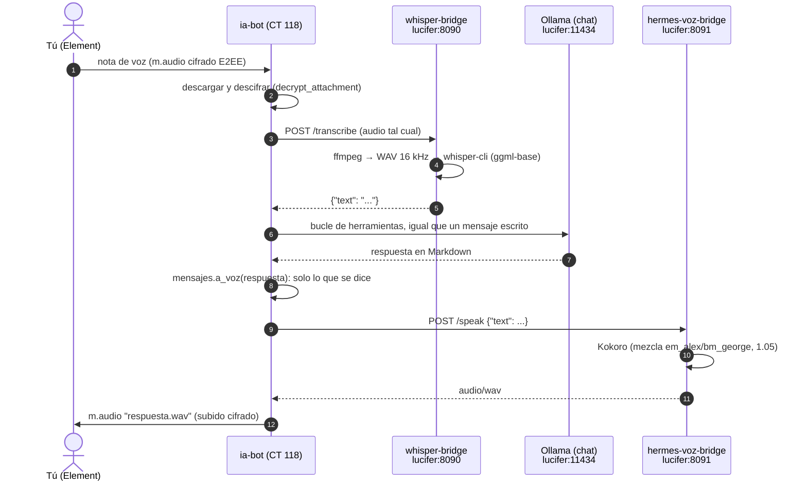
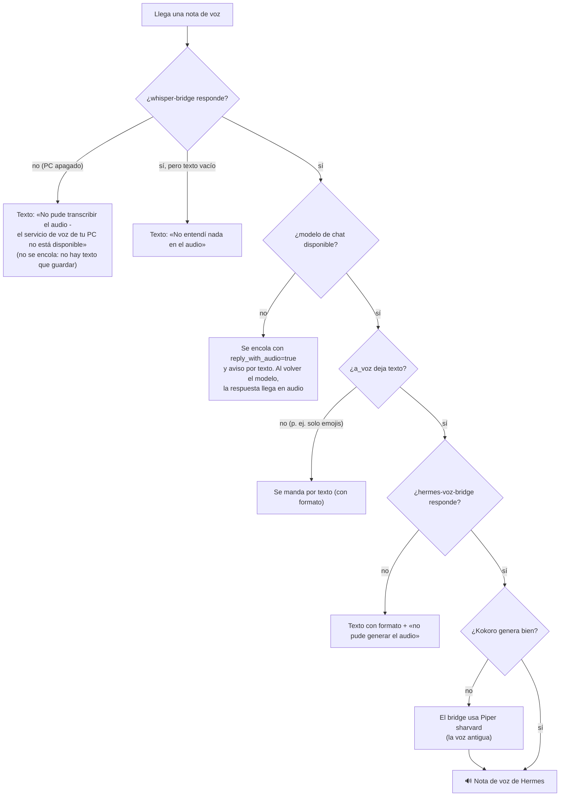
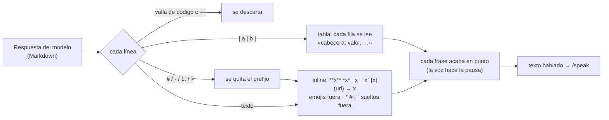
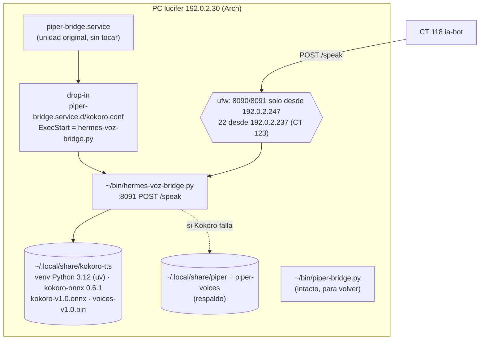

# Hermes — voz (audio → audio)

Fecha: 24-09-2026. Si le mandas a Hermes una nota de voz, contesta con otra nota
de voz; si le escribes, contesta por escrito. Todo se procesa en tu red: la voz
corre en el PC `lucifer` (192.0.2.30), igual que el modelo de chat.

Cambios del 24-09:

- **El texto que se lee ya no lleva Markdown** (`mensajes.a_voz`, commit `719c5c8`).
  Antes Piper leía en voz alta los asteriscos, las almohadillas y las barras de las tablas.
- **Voz nueva con Kokoro**, más humana y con carácter de Hermes, en lugar de Piper
  `es_ES-sharvard-medium`.

Copia de las piezas que viven en `lucifer`, fuera de Ansible: `scripts/lucifer/`.

## 1. Recorrido de un audio



Tiempos máximos del bot (`voice_client.py`): 4 s para conectar y 60 s para
transcribir o sintetizar. Kokoro, en CPU, tarda unos 3 s por cada 14 s de audio;
una frase corta, 0,5 s.

### Cuando algo falla



Los textos de respaldo van con formato (`a_html`), así que Element no enseña
`**`. Antes del 24-09 iban en crudo.

## 2. Qué se lee: `mensajes.a_voz`

El modelo escribe en Markdown para Element (`a_html` lo convierte en formato).
Para la voz, `a_voz` deja solo el texto hablado:



| Markdown del modelo | Lo que se lee |
|---|---|
| `La IP es **192.0.2.3** y el CT es *plex*, puerto `` `32400` `` | La IP es 192.0.2.3 y el CT es plex, puerto 32400. |
| `## Agenda` / `- Cine a las 19:00` / `- Cena` | Agenda. Cine a las 19:00. Cena. |
| `\| Servicio \| Estado \|` / `\|---\|---\|` / `\| **radarr** \| caido \|` | Servicio: radarr, Estado: caido. |
| `🔴 Mira [la guia](https://x.y/z)` | Mira la guia. |
| `Usa get_hefesto_status. ¿Vale?` | Igual: no toca identificadores ni `¿?` |

Pruebas: `python3 -m unittest scripts/evals/test_mensajes.py` (clase `VozTests`).

## 3. La voz: Kokoro en `lucifer`



### Cómo se eligió la voz

Seis muestras con el mismo texto, una respuesta típica de Hermes, en
`~/Music/hermes-voces/` de `lucifer` (`texto.txt` es el texto). Para comprobar que
se entendían, cada una se transcribió con el propio whisper-bridge:

| Muestra | Voz | Coincidencia con el texto |
|---|---|---|
| `0-piper-actual` | Piper `sharvard` (la de antes) | 87 % |
| `1-piper-ajustada` | Piper, voz M, más lenta, pausas | 89 % |
| `2-kokoro-alex` | `em_alex` | 88 % |
| `3-kokoro-santa` | `em_santa` | 89 % |
| **`4-kokoro-alex-grave-mezcla`** | **65 % `em_alex` + 35 % `bm_george`, 0.95** | **88 %** |
| `5-kokoro-dora-femenina` | `ef_dora` | 89 % |
| `6-kokoro-mezcla-1.05` | La 4 a 1.05 (la definitiva) | — |

Lo que falta hasta el 100 % viene de que Whisper escribe los números en cifras
y oye «CT» como «cete». La claridad es la misma con Kokoro que con Piper.

**Elegida: la 4**, más grave y con más aplomo. Después se pidió un 10 % más rápida:
`VELOCIDAD` pasó de 0.95 a 1.05. Con el mismo texto, el audio pasó de 15,7 s a 14,9 s;
las pausas entre frases no se acortan.

Kokoro tiene 3 voces en español (`ef_dora`, `em_alex`, `em_santa`). La mezcla suma
los vectores de estilo de dos voces con sus pesos, y `lang="es"` mantiene la
pronunciación española.

## 4. Operación

Cambiar la voz o la velocidad: editar `MEZCLA` y `VELOCIDAD` al principio de
`~/bin/hermes-voz-bridge.py` en `lucifer` (y la copia en `scripts/lucifer/`), y:

```bash
ssh lucifer@192.0.2.30 'sudo systemctl restart piper-bridge'
```

Probar una muestra sin pasar por Element (desde `lucifer`):

```bash
curl -s -X POST localhost:8091/speak -H 'Content-Type: application/json' \
     -d '{"text":"Hola, soy Hermes."}' -o /tmp/prueba.wav
```

Volver a Piper:

```bash
sudo rm /etc/systemd/system/piper-bridge.service.d/kokoro.conf
sudo systemctl daemon-reload && sudo systemctl restart piper-bridge
```

Reinstalar desde cero (si se pierde el disco de `lucifer`):

```bash
curl -LsSf https://astral.sh/uv/install.sh | env UV_NO_MODIFY_PATH=1 sh
D=~/.local/share/kokoro-tts; mkdir -p $D && cd $D
~/.local/bin/uv venv --python 3.12 venv
~/.local/bin/uv pip install --python venv/bin/python kokoro-onnx soundfile
U=https://github.com/thewh1teagle/kokoro-onnx/releases/download/model-files-v1.0
curl -fL --retry 5 --retry-all-errors -O $U/kokoro-v1.0.onnx -O $U/voices-v1.0.bin
install -m755 scripts/lucifer/hermes-voz-bridge.py ~/bin/   # desde una copia del repo
sudo install -D -m644 scripts/lucifer/piper-bridge-kokoro.conf \
     /etc/systemd/system/piper-bridge.service.d/kokoro.conf
sudo systemctl daemon-reload && sudo systemctl restart piper-bridge
```

El 24-09 la primera descarga de GitHub falló con un error de TLS puntual, y
funcionó al reintentar; por eso el `--retry`.

## 5. Acceso del CT 123 a `lucifer`

Lo autorice el 24-09 para montar esto: `lucifer@192.0.2.30` con la
clave de `agent@agents`, restringida con `from="192.0.2.237"`, y regla `ufw` del
puerto 22 solo desde esa IP. Había una línea antigua con la misma clave forzada a
`git-shell`, de cuando el repo central vivía en `lucifer`, y SSH usaba esa. Se borró.

Para quitar el acceso: borrar la línea `from="192.0.2.237" …` de
`~/.ssh/authorized_keys` y
`sudo ufw delete allow from 192.0.2.237 to any port 22 proto tcp`.
